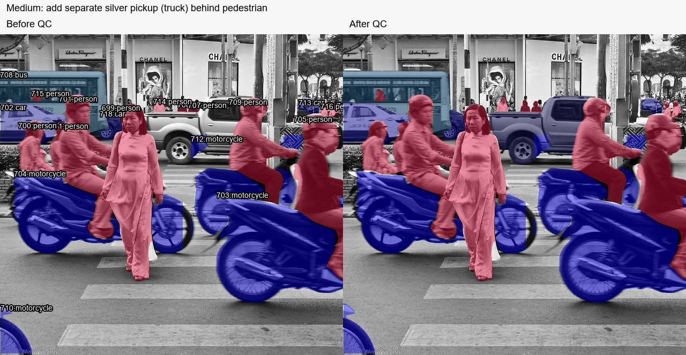
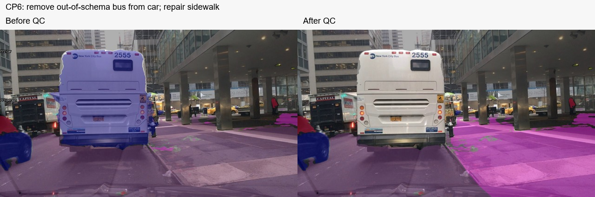
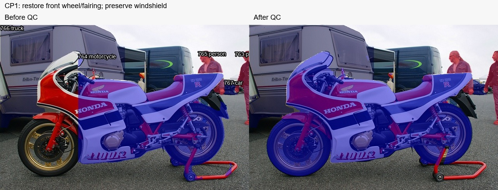
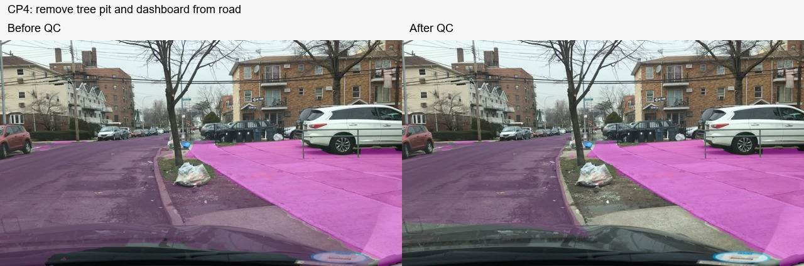

# Báo cáo thực hành Day 3 — Trịnh Xuân Toàn

- Mã định danh trong tên repo: **2A202603121**. Chưa có xác nhận riêng về mã học viên do lớp cấp.
- Ngày thực hiện và kiểm lại: **11–12/11/2026**, Asia/Saigon; CVAT local `http://localhost:8080`, phiên bản 2.74.1.
- Công cụ: CVAT, CVAT AI Helper, YOLO26s-seg, SegFormer B0 Cityscapes; MobileSAM dùng để hỗ trợ sửa vùng CP1 và tạo đề xuất pickup Medium trong lượt QC cuối. Python, Pillow, OpenCV và bộ scorer của repo được dùng để kiểm/export và tự đánh giá.
- Report này tổng hợp từ export, log thao tác và kiểm ảnh có hỗ trợ AI. Các sửa đổi tự động do assistant thực hiện theo yêu cầu của học viên được ghi rõ, không mô tả thành thao tác vẽ tay của học viên.
- Đã sử dụng `tiers_gt.zip` do học viên cung cấp để tự đánh giá sau bản export ban đầu. Không chép mask ground truth thành bài nộp, không đưa reference vào fork.

## 1. Bài đã nộp

Các file dưới đây đã được tạo bằng chức năng dataset export của CVAT và đưa vào `submissions/`. Giữ nguyên nội dung bên trong ZIP; chỉ đặt tên ZIP theo mã task. Số ảnh là ảnh có annotation trong export, không phải chứng nhận mọi biên/vật đều đúng. Chưa có xác nhận nộp link trên LMS.

| Task | File ZIP đúng tên | Ảnh có annotation/export | Điểm tối đa (coach chấm sau) |
| --- | --- | ---: | ---: |
| easy_semantic | `submissions/easy_semantic.zip` | 3 / 3 | 20 |
| medium_instance | `submissions/medium_instance.zip` | 3 / 3 | 32 |
| hard_panoptic | `submissions/hard_panoptic.zip` | 2 / 2 | 30 |
| cp1_holes | `submissions/cp1_holes.zip` | 1 / 1 | 3 |
| cp2_slice | `submissions/cp2_slice.zip` | 1 / 1 | 3 |
| cp5_occlusion | `submissions/cp5_occlusion.zip` | 1 / 1 | 3 |
| cp3_thin | `submissions/cp3_thin.zip` | 1 / 1 | 3 |
| cp4_curb | `submissions/cp4_curb.zip` | 1 / 1 | 3 |
| cp6_coverage | `submissions/cp6_coverage.zip` | 1 / 1 | 3 |
| **Tổng tối đa** | 9 ZIP, 14 ảnh | | **100** |

Semantic dùng Segmentation mask 1.1; instance/panoptic dùng COCO 1.0. Medium có 67 mask, Hard có 52 mask; checkpoint instance CP1/CP2/CP5 có lần lượt 5/12/23 mask. Đây là số mask xuất, không phải số object đúng theo reference.

Kết quả tự kiểm cấu trúc được lưu ở [submission-qc.json](../../reports/submission-qc.json). Điểm tự đánh giá ba tier và giới hạn của phép đo được lưu ở [SCORECARD.md](../../reports/tiers/SCORECARD.md). Checkpoint chưa có reference nên không tự cộng điểm /18 hay kết luận tổng điểm /100.

## 2. Một quyết định trước khi dùng gợi ý

**Chưa đủ chi tiết để xác minh yêu cầu này.** Trong trao đổi, học viên trả lời “có” khi được hỏi đã tự vẽ object Medium trước gợi ý hay chưa, nhưng chưa cung cấp tên ảnh, vị trí, class và quy tắc chọn biên của object đó. ZIP và snapshot chỉ cho biết trạng thái nhãn, không chứng minh thứ tự vẽ so với thời điểm xem gợi ý.

Vì vậy, report không tự gán một object cụ thể làm bằng chứng đã vẽ tay trước AI. Cần học viên bổ sung mô tả thật hoặc báo rõ với coach nếu không đáp ứng điều kiện này. Việc sửa hoặc thêm object sau đó không thể dùng làm bằng chứng hồi tố.

Một quyết định **sau gợi ý**, đã có bằng chứng: ảnh Medium `000000181542.jpg`, pickup bạc ở hậu cảnh, khoảng `(265,119)–(482,284)` trên ảnh 640×600. Xe có thùng hàng nên dùng `truck`; chỉ giữ phần nhìn thấy, không tô xuyên người đi bộ ở giữa hoặc xe máy phía trước. Assistant tạo mask gợi ý bằng MobileSAM theo box, kiểm ảnh, loại vùng chồng nhãn có sẵn, rồi thêm một instance vào CVAT. Đây không phải object tự vẽ trước gợi ý.

## 3. Một lỗi tìm thấy và sửa

- **Task/ảnh/vùng:** `cp6_coverage`, ảnh `7daa6479-67988f3f.jpg`, chiếc bus trắng “New York City Bus 2555” ở giữa ảnh.
- **Loại lỗi:** sai class. Vùng thân bus lớn đang được tô chung vào semantic mask `car`.
- **Bằng chứng quan sát:** thân xe lớn, nhiều cửa sổ, biển hiệu bus và số xe 2555 nhìn rõ; schema CP6 có `car` nhưng không có `bus`. Không được đổi nghĩa bus thành car chỉ vì thiếu lớp.
- **Hành động:** trong lượt QC có hỗ trợ AI, assistant bỏ thành phần mask của bus khỏi `car`, giữ các xe con khác và không tạo label mới ngoài schema. Đồng thời chuyển phần lát gạch đi bộ bên phải bó vỉa từ `road` sang `sidewalk` trên phần pixel trước đó đã tô.
- **Lưu/export:** các PATCH update được CVAT xác nhận HTTP 200; đã export lại `cp6_coverage.zip` và chạy kiểm cấu trúc. CP6 chưa có reference, không khẳng định điểm tăng hoặc coverage 100%.

Các sửa khác có bằng chứng gồm phục hồi bánh trước/kính chắn gió CP1, bỏ vùng đất quanh gốc cây và nắp xe khỏi `road` CP4, bổ sung pickup Medium. Ảnh đối chiếu và chi tiết nằm trong [biên bản QC](../../reports/QC-FINAL.md).

Đã chạy scorer trước và sau các lần hỗ trợ AI. Kết quả tự đánh giá sau xem reference chỉ phản ánh mức khớp với reference, không chứng minh chất lượng làm độc lập. Không tự ghi PASS/top 3/bonus. Số mới nhất là [scorecard.json](../../reports/tiers/scorecard.json).

## 4. Ba ca chưa chắc hoặc đã cân nhắc

Các ca sau được ghi từ ảnh/quy tắc trong lượt QC có hỗ trợ AI, không tuyên bố đây là ghi chép tự vẽ độc lập của học viên trước khi dùng công cụ.

| Ảnh/vị trí | Hai cách hiểu có thể | Quy tắc/chứng cứ | Quyết định hoặc câu hỏi cho coach |
| --- | --- | --- | --- |
| CP1 `000000144300.jpg`: kính chắn gió, bánh trước và giá chống đỏ của xe máy | Khoét kính/vành bánh thành lỗ; hoặc giữ phần vật theo quy tắc bài. Giá chống có thể bị model gộp vào xe | Kính/chi tiết nằm trong vật không tự động là lỗ nền. Giá chống đỏ tách rời với kết cấu xe cần phân biệt | Giữ kính và vùng vật theo quy tắc CP1; phục hồi bánh trước/fairing bị thiếu, loại phần giá chống nằm ngoài xe. Phương tiện caravan phía sau còn cần coach xác nhận taxonomy phù hợp |
| CP4 `7d83710e-4697c3b2.jpg`: gốc cây và phần lối đi/driveway bên phải | Cùng màu xám nên tô road; hoặc phân biệt sidewalk/đất/đường theo chức năng | Có bó vỉa ngăn mặt đường với bồn đất và lối đi; nắp xe ở mép dưới không phải road | Bỏ bồn đất/nắp xe khỏi road; giữ đường biên theo phía mặt đường của bó vỉa. Đoạn driveway nối lối đi vẫn cần kiểm kỹ theo guideline |
| CP6 `7daa6479-67988f3f.jpg`: bus trắng ở giữa ảnh | Ép sang car để tăng độ phủ; hoặc để trống vì bus không nằm trong schema | Danh sách class không có bus; không được invent mapping hoặc label để đạt coverage | Bỏ nhãn car khỏi bus; giữ pixel ngoài schema không gán. Không coi coverage thấp hơn sau sửa là bằng chứng sửa sai |

