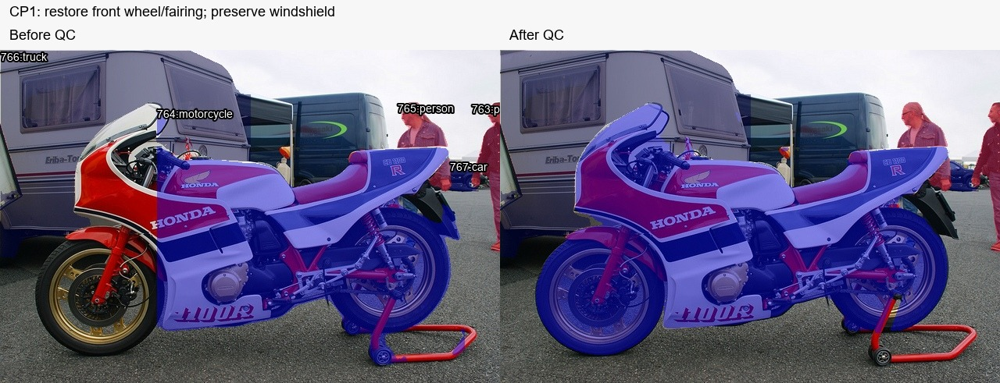
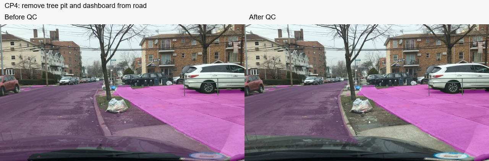
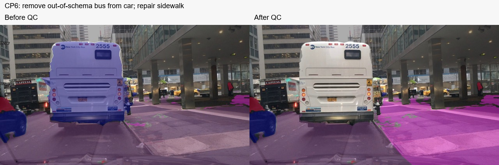
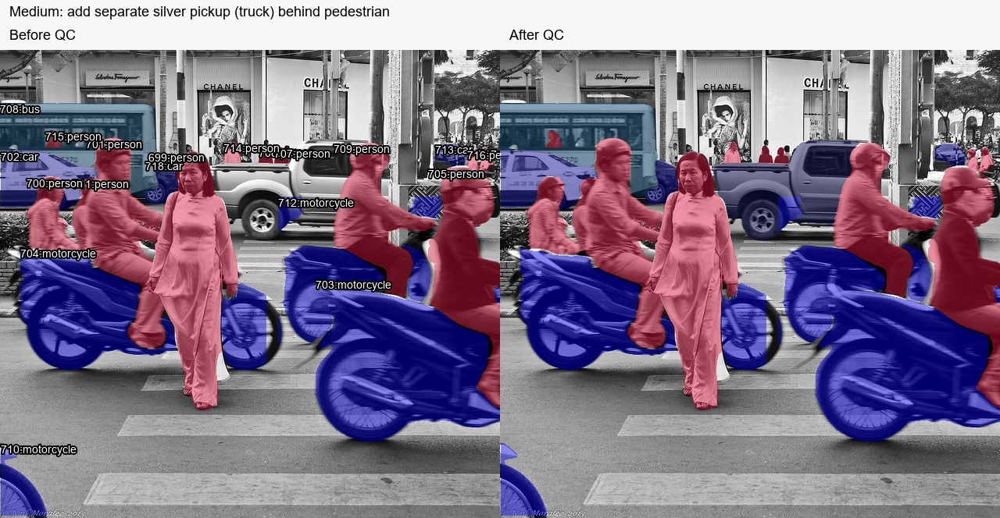

# Kiểm và sửa bài Day 3 — 12/11/2026

Bản này ghi kết quả kiểm ảnh và sửa nhãn có hỗ trợ AI theo yêu cầu của học viên,
không phải chứng nhận hoàn thành thao tác cá nhân hoặc đánh giá chuyên gia mọi pixel.
Report cá nhân: [2A202603121_TrinhXuanToan.md](../report/individual/2A202603121_TrinhXuanToan.md).

## Phạm vi kiểm

Đã xem đối chiếu ảnh gốc và overlay của đủ 14 ảnh từ 9 job CVAT local. Trước sửa
lưu snapshot riêng ngoài repo public. Không đọc mật khẩu/token; không đưa snapshot,
ground truth hoặc gói `tiers_gt.zip` lên GitHub. Các mask sửa được tạo từ ảnh gốc,
prompt model và biên quan sát, không chép reference mask. ZIP cuối được tạo bởi
dataset exporter CVAT 2.74.1, không sửa JSON/PNG bên trong để qua tự kiểm.

| Task | Ảnh đã xem | Kết quả QC của lượt này |
| --- | ---: | --- |
| Easy | 3 | Đã có mask cả ba ảnh sau lượt bổ sung trước; giữ bản hiện tại. Ranh sidewalk/vegetation còn cần kiểm chi tiết |
| Medium | 3 | Thêm một pickup bạc riêng ở ảnh 000000181542.jpg; class truck theo thùng hàng, loại phần bị người/xe máy che |
| Hard | 2 | Kiểm stuff/thing và các vật sát nhau. Phóng to xe đỏ dưới phải ảnh 000000460147.jpg: là minivan, giữ car. Thử đổi bus đã khôi phục |
| CP1 | 1 | Phục hồi bánh trước, kính chắn gió/fairing xe máy; loại giá chống tách rời ngoài xe và cập nhật vùng xe máy che phương tiện phía sau |
| CP2 | 1 | Kiểm các xe sát nhau vẫn là instance riêng; giữ 12 mask hiện có, chưa có reference để xác nhận đủ số vật |
| CP3 | 1 | Kiểm lớp pole/traffic sign/road/sky. Giữ bản hiện tại; nét rất mảnh và biên cành/cột còn là hạn chế model |
| CP4 | 1 | Bỏ đất quanh gốc cây/nắp xe khỏi road; dừng road ở phía mặt đường của bó vỉa |
| CP5 | 1 | Xem xe máy/người/xe phía sau bị che; giữ các instance hiện có, không tô xuyên phần bị che |
| CP6 | 1 | Bỏ bus trắng lớn khỏi car vì ngoài schema; chuyển vùng lát gạch bên phải bó vỉa từ road sang sidewalk |

## Bằng chứng trước/sau

Ảnh dùng màu label của job. Thay đổi màu/class không tự chứng minh chất lượng.
Nhật ký tóm tắt: [changes.json](qc-review/changes.json). Không đưa nội dung reference
vào các ảnh này; ảnh gốc thuộc bộ input công khai của bài.

## Tự kiểm cuối

- 9/9 ZIP có mặt, 0 lỗi hợp đồng và 0 file thiếu theo `inspect_submissions.py`.
- Semantic có đủ tên ảnh; COCO có segmentation RLE, class/ảnh đúng schema.
- Medium: 67 mask; Hard: 52 mask; CP1/CP2/CP5: 5/12/23 mask. Số này không đồng
  nghĩa số vật đúng. Các PATCH sửa/tạo được CVAT xác nhận HTTP 200, sau đó export lại.
- Scorer chạy trên reference do học viên cung cấp: Easy **16,2/20**, Medium
  **14,5/32**, Hard **15,5/30**, tổng **46,2/82**. Trước lượt QC cuối là **45,3/82**.
- Medium metric tăng từ 0,592 lên 0,604; 53 TP, 14 FP, 18 FN. Vẫn còn vật
  thiếu/thừa hoặc mask chưa khớp; không tuyên bố bài đạt chất lượng tối đa.
- Hard PQ 0,433; sidewalk/bicycle chưa ghép được segment đạt ngưỡng trong reference.
  Không dùng điểm thấp làm lý do tự chép đáp án hoặc đổi class trái bằng chứng ảnh.
- Checkpoint không có ground truth trong gói ba tier; chưa chấm /18 và không tự
  cộng vào điểm /100. Xem [SCORECARD](tiers/SCORECARD.md) và [QC JSON](submission-qc.json).

## Giới hạn và việc học viên cần xác nhận

Mục object Medium tự vẽ trước gợi ý chưa có mô tả ảnh/vị trí/class/quy tắc từ học
viên; không thể suy ra thứ tự thao tác chỉ từ annotation/export. Report đã ghi rõ
thay vì tạo bằng chứng giả. Tính hợp lệ theo yêu cầu bài cá nhân do coach đánh giá.

Đây là bản cập nhật sau 12:00 ngày 12/11/2026 (UTC+7), muộn hơn hạn ghi trong đề.
Không tự nhận được gia hạn hoặc đã nộp LMS. Push GitHub không thay thao tác nộp link
trên LMS. Học viên cần kiểm trạng thái LMS và trao đổi với coach về thời điểm nộp.
